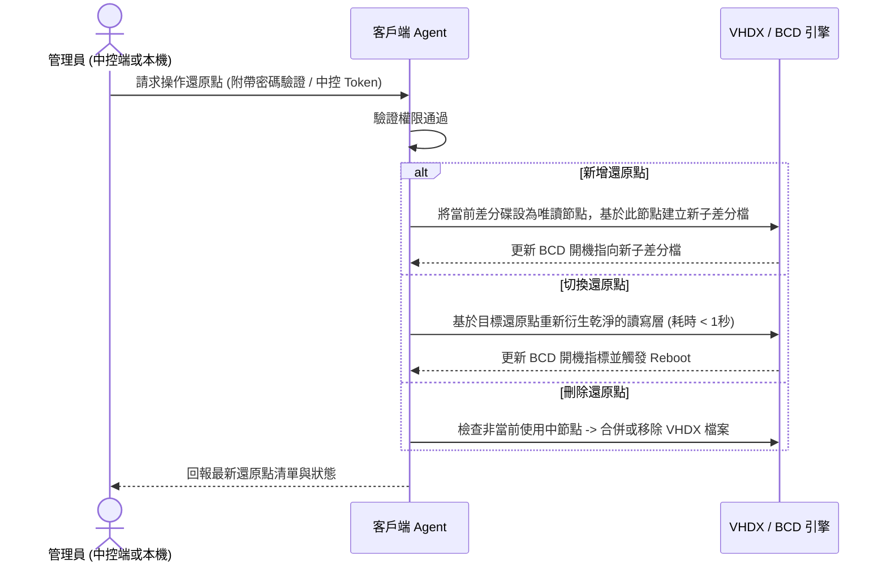

# 區域網路還原與映像派送系統 — 技術規格白皮書 (`SPEC.md`)

> [!IMPORTANT]
> 本文件為 **規格驅動開發（Spec-Driven Development）** 的唯一真實來源（Single Source of Truth）。所有前端 UI、Go 中控端核心、客戶端 Agent 與自動化腳本皆須嚴格遵守本規格定義之資料結構與通訊契約。

---

## 1. 系統架構與設計原則

### 1.1 核心架構模式：Thin Core + Independent Workers
- **中控端（Control Hub）**：採用 **Go (Golang)** 建構單一執行檔，內嵌 **React + Tailwind CSS** 前端靜態資源與 **SQLite** 輕量資料庫。
- **客戶端代理（Client Agent）**：採用 **Go** 編譯為 Windows 系統服務（Windows Service），附加輕量級本機管理 GUI（所有敏感操作強制驗證管理員密碼）。
- **底層功能模組（Workers）**：Worker 的概念名稱**必須等於 Go package 名稱**（舊稱 `wol_worker` / `vhdx_worker` / `pxe_worker` / `multicast_worker` / `net_preserve_worker` 一律廢止，對照表見 [`AGENT.md`](./AGENT.md) §3）。
  - `wol`（`internal/workers/wol`）：發送 UDP Magic Packet 喚醒指定電腦。
  - `vhdx`（`internal/workers/vhdx`）：操作 Windows `diskpart` 與 `bcdedit` 管理差分虛擬硬碟還原點。
  - `pxe`（`internal/workers/pxe`）：提供微型 DHCP Proxy / TFTP / HTTP 引導服務，載入救援環境（WinPE）。
  - `multicast`（`internal/workers/multicast`）：封裝並調用 `udp-sender`（母機端）與 `udp-receiver`（子機端）進行點對多高速直傳。
  - `netpreserve`（`internal/workers/netpreserve`，含 `capture` / `restore`）：負責派送前備份 IP/電腦名稱，以及派送後自動注入還原。

> [!WARNING]
> `pxe` 目前在 [`TASKS.md`](./TASKS.md) 中**沒有任何對應 Task**，且其前置決策（UEFI/Legacy、與現有 DHCP 共存、WinPE 映像內容）尚未定案，見 §1.2 的 D2。

```mermaid
flowchart TB
    subgraph ControlCenter["中控端 (Go Thin Core + Web UI)"]
        UI["React 監控儀表板"]
        Hub["Go Core (State & WebSocket Hub)"]
        DB[("SQLite (IP 分組/密碼/任務紀錄)")]
        PXE["PXE / HTTP 引導模組"]
        WOL["WOL 喚醒模組"]
        UI <-->|WebSocket / REST| Hub
        Hub <--> DB
        Hub --> PXE
        Hub --> WOL
    end

    subgraph MasterNode["母機客戶端 (Master Client)"]
        MAgent["Client Agent (Go Service)"]
        Sender["udp-sender (讀取硬碟串流)"]
    end

    subgraph TargetNodes["子機客戶端群組 (Target Clients - 依 IP 分組)"]
        TAgent["Client Agent (Go Service)"]
        NetSnap["Network State Snapshot (IP/Hostname 備忘)"]
        Receiver["udp-receiver (寫入硬碟)"]
        VHDX["VHDX 差分還原點引擎"]
    end

    Hub <-->|指令與心跳 (TCP/WS)| MAgent
    Hub <-->|指令與心跳 (TCP/WS)| TAgent
    WOL -.->|UDP Magic Packet| TargetNodes
    Sender ===>|UDP Multicast 高速直傳串流| Receiver
```

### 1.2 尚未決策事項（實作前必須先補決策）

> [!WARNING]
> 以下題目 **本文件尚未定義、且不是實作階段可以自行假設** 的架構選擇。動手前必須先確認決策（見 [`DECISIONS.md`](./DECISIONS.md) 的 D1–D8），相關 Task 在決策完成前不得開工。

| 編號 | 待決策題目 | 阻塞的 Task |
| :--- | :--- | :--- |
| D1 | 客戶端 Service（LocalSystem）與本機 GUI 的分離方式，以及兩者之間的本機 IPC 契約與授權（誰能呼叫、驗證 Token 從何而來） | 2.3、3.2 |
| D2 | PXE/WinPE 引導策略：UEFI vs Legacy、Secure Boot、ProxyDHCP vs DHCP 選項 66/67、WinPE 映像內容與建置流程 | **（尚無 Task，需新增）** |
| D3 | 母機映像格式與 pipeline：整碟或單一分割區、`partclone`/`wimlib` 與 `udpcast` 的串接方式、目標碟容量與分割配置一致性前提 | 4.2 |
| D4 | 目標機 OS 版本要求（VHDX 原生開機僅支援 Pro/Enterprise/Education）與「實體機轉 VHDX 原生開機」的初次建置流程 | 3.3 |
| D5 | Hub ↔ Agent 的傳輸安全與 Agent 身分驗證（TLS？指令簽章？共用密鑰？） | 1.3、3.2 |
| D6 | Hub 管理後台的認證／授權機制（Session、Token 或 Basic；以及 CSRF/CORS 政策） | 1.3、2.2 |
| D7 | 離線客戶端的 MAC 取得來源（手動建檔／ARP 掃描／DHCP lease 匯入），否則 WOL 無法喚醒從未上線的機器 | 3.1 |
| D8 | 「VHDX 差分還原點」與「母機群播派送」兩套機制的關係與資料保留策略（派送後原有還原點是否保留／如何處置） | 4.2、3.3 |

---

## 2. 核心資料結構定義 (Data Schemas)

### 2.1 網路身分快照 (`NetworkIdentity`)
用於派送前備忘客戶端原始網路狀態，並在映像檔覆蓋完成後原樣復原。

```json
{
  "mac_address": "AA:BB:CC:11:22:33",
  "ip_mode": "STATIC",
  "ip_address": "192.168.1.101",
  "subnet_mask": "255.255.255.0",
  "default_gateway": "192.168.1.1",
  "dns_servers": ["8.8.8.8", "1.1.1.1"],
  "original_hostname": "LAB-PC-01",
  "captured_at": "2026-11-10T23:00:00Z"
}
```
- `ip_mode`: 列舉值 `"STATIC"`（固定 IP）或 `"DHCP"`（自動取得）。
- 當 `ip_mode == "DHCP"` 時，派送後僅還原 `original_hostname`，並將網卡設回 DHCP 自動取得模式。

### 2.2 還原點結構 (`RestorePoint`)
客戶端與中控端皆可檢視、新增、刪除與切換的本機還原點。差分鏈深度以 `depth` 表示（base 為 `0`），**上限為 5（MUST）**；超過上限時新增操作必須被拒絕（`RESTORE_POINT_LIMIT`），不得自動合併。所謂「切換」僅指重建乾淨讀寫層並改寫開機指標（不含重開機時間）。

```json
{
  "point_id": "rp_20261110_01",
  "name": "期中考乾淨環境",
  "description": "已安裝 Office 與 Python 3.12",
  "vhdx_file": "D:\\RestoreStorage\\diff_20261110_01.vhdx",
  "parent_id": "rp_base",
  "depth": 1,
  "size_bytes": 0,
  "is_base": false,
  "is_active": true,
  "state": "READY",
  "created_by": "ADMIN_REMOTE",
  "created_at": "2026-11-10T10:30:00Z"
}
```

**欄位規則**
- `depth`：base 為 `0`，子節點 = `parent.depth + 1`；有效範圍 `0 ≤ depth ≤ 5`。
- `size_bytes`：該差分檔實際佔用位元組；尚未計量時為 `0`。
- `state`：`READY`（可用）、`CREATING`（建立中）、`MERGING`（合併中，**屬非秒級操作**）、`BROKEN`（檔案缺失或父節點遺失）。
- `is_active`：同一 `client_id` 底下**僅能有一個** `true`。
- `created_by`：`ADMIN_LOCAL`（本機面板）、`ADMIN_REMOTE`（中控端）、`SYSTEM`（系統自動建立）。
- 刪除規則：`is_active == true` 的節點**禁止刪除**（`INVALID_STATE`）；含有子節點時的刪除策略（合併深度或先刪子節點）**尚未決策**，決策前實作必須直接拒絕。

### 2.3 客戶端節點與 IP 群組 (`ClientNode` & `IPGroup`)
系統以 **IP 位址** 為管理與分組依據，不受電腦名稱是否重複影響。`client_id` 則必須是**安裝時產生、永久不變**的穩定鍵，**禁止由 IP 或 MAC 推導**（IP 會隨 DHCP 變動，MAC 可能有多張網卡或變更），否則歷史任務與還原點會斷鏈。

```json
{
  "client_id": "cli_9f2c4b1e8a7d4c3f",
  "current_ip": "192.168.1.101",
  "mac_address": "AA:BB:CC:11:22:33",
  "hostname": "LAB-PC-01",
  "agent_version": "0.1.0",
  "group_id": "grp_row_1",
  "status": "ONLINE_WINDOWS",
  "auto_restore_on_reboot": true,
  "active_point_id": "rp_20261110_01",
  "restore_point_ids": ["rp_base", "rp_20261110_01"],
  "network_snapshot": {},
  "last_task_id": null,
  "progress_percent": null,
  "error_message": null,
  "last_seen": "2026-11-10T23:04:00Z"
}
```

**欄位規則**
- `client_id`：格式 `^cli_[0-9a-f]{16}$`（安裝時產生之 UUID 前 16 碼）；舊格式 `cli_192_168_1_101`（由 IP 推導）**廢止**。
- `current_ip`：可變欄位；群組劃分以 `IPGroup.ip_list` 為準。
- `restore_point_ids`：取代舊版內嵌的 `restore_points` 陣列，僅存 ID 參照（物件本體見 §2.2）。
- `network_snapshot`：派送前擷取的 `NetworkIdentity`；尚未擷取時為 `{}`。
- `progress_percent`：`0–100`；非派送中為 `null`。
- `error_message`：最近一次錯誤訊息；無錯誤為 `null`。
- `agent_version`：語意化版本字串，供後續升級判定。
- `last_task_id`：最近參與的 `DeployTask.task_id`；無則 `null`。
- `status` 狀態機列舉（**合法轉移見 §2.6**）：
  - `"OFFLINE"`：關機或離線
  - `"WAKING_UP"`：已發送 WOL 封包，等待回應
  - `"ONLINE_WINDOWS"`：正常進入 Windows 運作中
  - `"ENTERING_PE"`：正在重啟進入 PXE/WinPE 環境
  - `"READY_FOR_CAST"`：已在救援環境待命，準備發送或接收群播
  - `"DEPLOYING"`：映像檔派送/接收進行中
  - `"POST_RESTORING_NET"`：派送完畢，正在還原原始 IP 與電腦名稱
  - `"ERROR"`：執行異常

```json
{
  "group_id": "grp_row_1",
  "group_name": "A教室 - 第一排",
  "ip_list": [
    "192.168.1.101",
    "192.168.1.102",
    "192.168.1.103"
  ],
  "created_at": "2026-11-09T08:00:00Z"
}
```

**`IPGroup` 欄位規則**
- `group_id`：格式 `^grp_[a-z0-9_]+$`；新建時可省略，由 Hub 產生。
- **唯一性（MUST）**：`ip_list` 具全域唯一約束——同一 IP 在任一時間點只能屬於**一個**群組；資料庫必須有 `UNIQUE(ip)` 對應約束，衝突時 API 回 `IP_IN_OTHER_GROUP`（見 §5.1）。
- `ip_list`：正規化 IPv4 字串，去重並排序後儲存。
- 允許先將尚未上線的 IP 建入群組；該 IP 尚無 `ClientNode` 時，於 UI 顯示為預留項，待 Agent 首次回報後補齊。

### 2.4 派送任務 (`DeployTask`)

母機直傳群播任務的唯一識別物件；`task_id` 會出現在 WebSocket `DEPLOY_PROGRESS` payload 與 `GET /api/v1/tasks` 回應中。

```json
{
  "task_id": "task_9981",
  "state": "CASTING",
  "master_ip": "192.168.1.100",
  "target_ips": ["192.168.1.101", "192.168.1.102"],
  "created_at": "2026-11-10T23:08:00Z",
  "started_at": "2026-11-10T23:09:12Z",
  "finished_at": null,
  "error_code": null,
  "error_message": null
}
```

- `state` 狀態機列舉（**合法轉移見 §2.6**）：
  - `PENDING_PREPARE`：任務已建立，尚未下達 `CMD_PREPARE_DEPLOY`
  - `PREPARING`：已下達前置快照指令，等待 `NetworkIdentity` 回收
  - `READY`：**所有** `target_ips` 的 `NetworkIdentity` 皆已收妥，且全數回報 `READY_FOR_CAST`
  - `CASTING`：群播寫入中
  - `POST_RESTORE`：寫入完成，子機正在還原網路身分
  - `SUCCEEDED` / `FAILED` / `CANCELLED`：終態
- **紅線**：任一目標的 `NetworkIdentity` 未收妥時，`state` **不得**進入 `READY`，`CASTING` 亦不得開始（對應 [`AGENT.md`](./AGENT.md) §4.2）。
- 同一時間僅允許一個 `state ∉ {SUCCEEDED, FAILED, CANCELLED}` 的任務存在；重複發起回 `DEPLOY_IN_PROGRESS`。

### 2.5 WebSocket 訊息封套 (`WSMessage`)

所有 WebSocket 訊息（瀏覽器通道與 Agent 通道）共用同一封套：

```json
{
  "v": 1,
  "seq": 128,
  "event": "CLIENT_STATUS_CHANGED",
  "timestamp": "2026-11-10T23:10:05Z",
  "payload": {}
}
```

- `v`：契約版本，目前固定 `1`。
- `seq`：Hub 端單調遞增序號（每條連線各自計數），用於偵測漏事件與 Debug。
- `event`：唯一合法值列舉如下，**禁止自行新增未定義事件**（payload 定義見 §5.2、§5.3）：
  - 瀏覽器通道（Hub → 中控台）：`HELLO`、`CLIENT_STATUS_CHANGED`、`CLIENT_UPSERTED`、`GROUP_UPDATED`、`RESTORE_POINTS_UPDATED`、`WOL_SENT`、`TASK_CREATED`、`DEPLOY_PROGRESS`、`DEPLOY_FINISHED`、`DEPLOY_FAILED`、`AGENT_ERROR`
  - Agent 指令（Hub → Agent）：`CMD_PREPARE_DEPLOY`、`CMD_ENTER_PE`、`CMD_START_SENDER`、`CMD_START_RECEIVER`、`CMD_ABORT`、`CMD_COLLECT_RESTORE_POINTS`、`CMD_PING`
  - Agent 上報（Agent → Hub）：`AGENT_HELLO`、`AGENT_STATUS`、`AGENT_PROGRESS`、`NETWORK_IDENTITY`、`CMD_RESULT`

### 2.6 狀態機轉移表（唯一合法轉移）

**客戶端 `status`（§2.3）**

| From | 允許的 To | 觸發 |
| :--- | :--- | :--- |
| `OFFLINE` | `WAKING_UP` | `POST /api/v1/power/wol` 已送出 Magic Packet |
| `WAKING_UP` | `ONLINE_WINDOWS` | Agent 心跳恢復 |
| `WAKING_UP` | `OFFLINE` | 逾時（預設 120 秒）未收到心跳 |
| `ONLINE_WINDOWS` | `ENTERING_PE` | 下達 `CMD_ENTER_PE` 並取得 `CMD_RESULT` |
| `ONLINE_WINDOWS` | `OFFLINE` | 心跳逾時 |
| `ENTERING_PE` | `READY_FOR_CAST` | Agent 自 PE 環境回報 |
| `ENTERING_PE` | `ERROR` | 引導失敗或逾時 |
| `READY_FOR_CAST` | `DEPLOYING` | `CMD_START_SENDER` / `CMD_START_RECEIVER` 成功 |
| `READY_FOR_CAST` | `ONLINE_WINDOWS` | 任務取消，子機重開回原系統 |
| `DEPLOYING` | `POST_RESTORING_NET` | 寫入進度 100% |
| `POST_RESTORING_NET` | `ONLINE_WINDOWS` | 以原始 IP 重新連上 Hub |
| 任一狀態 | `ERROR` | Agent 回報錯誤或指令逾時 |
| `ERROR` | `OFFLINE` / `ONLINE_WINDOWS` | 管理員清除錯誤後重新連線 |

- 上表為**封閉集合**：未列出的轉移一律視為非法。Hub 收到非法轉移時必須忽略該回報、記錄 WARN，並回 `INVALID_STATE`，不得寫入 DB。
- `DEPLOYING` 與 `POST_RESTORING_NET` 期間，不得接受新的還原點操作，也不得發起第二次派送。

**任務 `DeployTask.state`（§2.4）**

| From | 允許的 To | 備註 |
| :--- | :--- | :--- |
| `PENDING_PREPARE` | `PREPARING` / `CANCELLED` | 管理員取消 |
| `PREPARING` | `READY` | 所有目標 `NetworkIdentity` 收妥 |
| `PREPARING` | `FAILED` / `CANCELLED` | 逾時或部分目標失敗 |
| `READY` | `CASTING` / `CANCELLED` | |
| `CASTING` | `POST_RESTORE` / `FAILED` | 僅允許「全部寫入完成」才進 `POST_RESTORE` |
| `POST_RESTORE` | `SUCCEEDED` / `FAILED` | |
| `SUCCEEDED` / `FAILED` / `CANCELLED` | —（終態） | 不可再轉移 |

---

## 3. 安全與權限規格 (Security Contract)

1. **客戶端全面密碼保護**：
   - 客戶端本機 UI 預設為鎖定檢視狀態。
   - 執行以下任一操作時，必須通過管理員密碼驗證（PBKDF2 / Bcrypt Hash 比對）：
     - 切換還原點（Switch Restore Point）
     - 新增還原點（Create Restore Point）
     - 刪除還原點（Delete Restore Point）
     - 切換「重開機自動還原」開關
     - 修改中控端連線設定或卸載服務
2. **中控端密碼同步**：
   - 中控端可透過加密通道統一派發新的管理員密碼 Hash 至所有在線客戶端，離線客戶端於下次上線時自動同步。

---

## 4. 關鍵業務流程規格 (Core Workflows)

### 4.1 流程一：新增 / 切換 / 刪除還原點（秒級還原）


### 4.2 流程二：母機直傳群播派送 ＋ IP/名稱自記憶復原
此流程實現**「不經伺服器中轉檔案」**以及**「派送後自動變回原本 IP 與電腦名稱」**。

```mermaid
sequenceDiagram
    participant Hub as 中控端 (Go Hub)
    participant Master as 母機 (如 192.168.1.100)
    participant Targets as 目標子機群 (依 IP 選取)

    Note over Hub,Targets: 階段 1：派送前網路身分自記憶 (Pre-Deploy Snapshot)
    Hub->>Targets: 下達 PREPARE_DEPLOY 指令
    Targets->>Targets: 讀取當前網卡設定 (Static IP/Mask/GW/DNS 或 DHCP) 與電腦名稱
    Targets->>Hub: 回傳 NetworkIdentity 備份存檔 (以 MAC 為索引雙重保險)
    Targets->>Targets: 亦將 NetworkIdentity 寫入本機 EFI/隱藏保留區

    Note over Hub,Targets: 階段 2：引導進入傳輸環境
    Hub->>Master: 指示重啟進入 PXE/WinPE (角色：SENDER)
    Hub->>Targets: 指示重啟進入 PXE/WinPE (角色：RECEIVER)
    Master-->>Hub: 回報 READY_FOR_CAST
    Targets-->>Hub: 全數回報 READY_FOR_CAST

    Note over Hub,Targets: 階段 3：母機對子機 UDP Multicast 高速直傳
    Hub->>Master: 啟動 udp-sender (讀取母機系統磁區串流)
    Hub->>Targets: 啟動 udp-receiver (寫入子機目標磁區)
    Master ===>> Targets: UDP Multicast 區塊串流直傳
    Targets-->>Hub: 每秒回報寫入進度 (%)、傳輸速率 (MB/s)

    Note over Hub,Targets: 階段 4：派送後原地復原 IP 與電腦名稱 (Post-Deploy Restore)
    Targets->>Targets: 映像寫入完成，掛載新系統離線 Registry 與網卡設定
    Targets->>Hub: 以 MAC 查詢或讀取保留區之 NetworkIdentity
    alt 派送前為固定 IP (STATIC)
        Targets->>Targets: 離線注入原始 IP、子網遮罩、預設閘道、DNS 與原始電腦名稱
    else 派送前為動態分配 (DHCP)
        Targets->>Targets: 清除母機殘留靜態 IP，設為 DHCP 自動取得，並注入原始電腦名稱
    end
    Targets->>Targets: 重開機進入全新 Windows 系統
    Targets-->>Hub: 以「原本的 IP」重新連上中控端，回報 DEPLOY_SUCCESS！
```

---

## 5. 通訊協定契約 (API & WebSocket Events)

### 5.1 中控端 REST API

**共通規範**
- 請求／回應一律 `application/json`；時間一律 UTC RFC 3339（例：`2026-11-10T23:10:05Z`）。
- 成功：`{ "ok": true, "data": <payload> }`；失敗：`{ "ok": false, "error": { "code": "...", "message": "...", "details": {} } }`。
- 除 `auth/*` 外，所有端點皆需管理員憑證（機制待決策 D6）；未通過一律 `401 UNAUTHORIZED`。
- **批次語意**：所有變更類端點統一接受 `"targets": { "ips": ["..."], "group_id": "..." }`（兩者擇一或併用；`group_id` 展開為其 `ip_list`），回應固定為 `"results": [{ "ip": "...", "ok": true, "error": null }]`；單台失敗不影響其他台，以 `results` 表達部分成功。

| 方法 | 路徑 | 說明 |
| :--- | :--- | :--- |
| `POST` | `/api/v1/auth/login` | 管理員登入（機制待決策 D6） |
| `POST` | `/api/v1/auth/logout` | 登出並作廢憑證 |
| `GET` | `/api/v1/clients` | 全量客戶端（`ClientNode[]`），可帶 `?group_id=` |
| `GET` | `/api/v1/clients/{ip}` | 單一客戶端狀態 |
| `PATCH` | `/api/v1/clients/{ip}/settings` | 切換 `auto_restore_on_reboot` 等設定（需管理員密碼 Token） |
| `GET` | `/api/v1/groups` | 群組清單（`IPGroup[]`） |
| `POST` | `/api/v1/groups` | 建立或更新群組（省略 `group_id` 視為新建） |
| `DELETE` | `/api/v1/groups/{group_id}` | 刪除群組（不影響客戶端狀態與還原點） |
| `POST` | `/api/v1/power/wol` | 喚醒指定 IP／群組（`targets`） |
| `GET` | `/api/v1/clients/{ip}/restore-points` | 讀取該客戶端還原點清單與 `active_point_id` |
| `POST` | `/api/v1/restore-points/action` | `{ "action": "create"\|"switch"\|"delete", "point_id"?, "name"?, "description"?, "targets": {...}, "admin_token": "..." }` |
| `POST` | `/api/v1/deploy/start` | `{ "master_ip": "...", "target_ips": ["..."] }`，成功回 `DeployTask` |
| `POST` | `/api/v1/deploy/cancel` | `{ "task_id": "..." }`；僅 `PENDING_PREPARE` / `PREPARING` / `READY` 可取消（見 §2.6） |
| `GET` | `/api/v1/tasks` | 任務清單（分頁 `?limit=&offset=`） |
| `GET` | `/api/v1/tasks/{task_id}` | 單一 `DeployTask` |
| `POST` | `/api/v1/agent/register` | Agent 註冊（身分驗證待決策 D5） |
| `POST` | `/api/v1/agent/heartbeat` | 心跳與狀態補報（Agent 主通道為 WebSocket，見 §5.3） |

**錯誤碼（`error.code`，封閉集合）**

| 代碼 | HTTP | 意義 |
| :--- | :--- | :--- |
| `UNAUTHORIZED` | 401 | 未登入、密碼／Token 錯誤或已過期 |
| `FORBIDDEN` | 403 | 已登入但無此操作權限 |
| `INVALID_ARGUMENT` | 400 | 參數格式錯誤（IP、`group_id`、`action` 等） |
| `NOT_FOUND` | 404 | 對象不存在 |
| `INVALID_STATE` | 409 | 當前狀態不允許此操作（見 §2.6） |
| `IP_IN_OTHER_GROUP` | 409 | 目標 IP 已屬於其他群組（見 §2.3 唯一性規則） |
| `RESTORE_POINT_LIMIT` | 409 | 差分鏈深度已達上限（見 §2.2） |
| `DEPLOY_IN_PROGRESS` | 409 | 已有進行中的派送任務 |
| `INTERNAL` | 500 | 未預期的伺服器錯誤 |

### 5.2 WebSocket 即時事件（瀏覽器通道）

- 端點：`ws://<hub-ip>:8080/ws`；正式環境是否升級 `wss://` 待決策 D5。此通道**只給中控台瀏覽器**，Agent 走 §5.3。
- 連線成功後 Hub 先送 `HELLO`。所有訊息一律包在 §2.5 的 `WSMessage` 封套內。
- **重連規則**：WebSocket 僅為推播通道，不保證不漏事件。前端重連成功後**必須**重新呼叫 `GET /api/v1/clients` 與 `GET /api/v1/tasks` 取全量狀態；`seq` 僅供偵測漏事件與 Debug，**不得**據此補資料。

| `event` | payload | 備註 |
| :--- | :--- | :--- |
| `HELLO` | `{ "server_time", "seq", "contract_version": 1 }` | 連線建立 |
| `CLIENT_STATUS_CHANGED` | `{ "client_id", "ip", "from", "to" }` | 見 §2.6 |
| `CLIENT_UPSERTED` | `{ "client": <ClientNode> }` | 首次回報或資料更新 |
| `GROUP_UPDATED` | `{ "group": <IPGroup> }` | |
| `RESTORE_POINTS_UPDATED` | `{ "ip", "restore_points": [<RestorePoint>] }` | |
| `WOL_SENT` | `{ "ips": ["..."], "macs": ["..."] }` | |
| `TASK_CREATED` | `{ "task": <DeployTask> }` | |
| `DEPLOY_PROGRESS` | `{ "task_id", "master_ip", "speed_mbps", "clients": [{ "ip", "progress", "status" }] }` | 任務進行中 |
| `DEPLOY_FINISHED` | `{ "task_id", "state": "SUCCEEDED", "finished_at" }` | 終態 |
| `DEPLOY_FAILED` | `{ "task_id", "error_code", "message", "failed_ips": ["..."] }` | 終態 |
| `AGENT_ERROR` | `{ "ip", "error_code", "message" }` | 非任務性錯誤 |

`DEPLOY_PROGRESS` 完整範例：

```json
{
  "v": 1,
  "seq": 128,
  "event": "DEPLOY_PROGRESS",
  "timestamp": "2026-11-10T23:10:05Z",
  "payload": {
    "task_id": "task_9981",
    "master_ip": "192.168.1.100",
    "speed_mbps": 105.2,
    "clients": [
      { "ip": "192.168.1.101", "progress": 68.5, "status": "DEPLOYING" },
      { "ip": "192.168.1.102", "progress": 68.5, "status": "DEPLOYING" }
    ]
  }
}
```

> [!NOTE]
> `speed_mbps` 為示意值。1GbE 實務上限約 118 MB/s；群播總速率另受交換器群播能力與接收端寫入速度限制，**不得**以本範例數字作為驗收基準。

### 5.3 客戶端指令通道（Hub ↔ Agent）

- 端點：`ws://<hub-ip>:8080/ws/agent`。Agent 主動連線，連上後先送 `AGENT_HELLO`（身分驗證待決策 D5）。
- 指令一律為 `WSMessage` 封套，`event` 以 `CMD_` 開頭，payload 必含 `cmd_id`（Hub 產生，Agent 必須原樣回帶）與 `expires_at`（逾時即作廢）。
- Agent 必須對每則指令回報 `CMD_RESULT`；Hub 逾時未收到時，將該客戶端標記為 `ERROR`（見 §2.6）。

**Hub → Agent 指令**

| `event` | payload | 預期效果 |
| :--- | :--- | :--- |
| `CMD_PREPARE_DEPLOY` | `{ "cmd_id", "task_id", "expires_at" }` | 回傳 `NETWORK_IDENTITY` |
| `CMD_ENTER_PE` | `{ "cmd_id", "role": "SENDER"\|"RECEIVER", "expires_at" }` | `ENTERING_PE` |
| `CMD_START_SENDER` | `{ "cmd_id", "target_ips", "expires_at" }` | 母機開始群播（`DEPLOYING`） |
| `CMD_START_RECEIVER` | `{ "cmd_id", "master_ip", "expires_at" }` | 子機開始接收（`DEPLOYING`） |
| `CMD_ABORT` | `{ "cmd_id", "reason" }` | 中止當前動作並回報 |
| `CMD_COLLECT_RESTORE_POINTS` | `{ "cmd_id" }` | 回傳 `RestorePoint[]` |
| `CMD_PING` | `{ "cmd_id" }` | 回 `CMD_RESULT` |

**Agent → Hub 上報**

| `event` | payload |
| :--- | :--- |
| `AGENT_HELLO` | `{ "client_id", "hostname", "agent_version", "mac_address", "current_ip" }` |
| `AGENT_STATUS` | `{ "client_id", "status", "reason"? }` |
| `AGENT_PROGRESS` | `{ "task_id", "percent", "speed_mbps", "phase" }` |
| `NETWORK_IDENTITY` | `{ "task_id", "identity": <NetworkIdentity> }` |
| `CMD_RESULT` | `{ "cmd_id", "ok", "error"? }` |

---

## 6. 實作里程碑（開發順序）

> [!IMPORTANT]
> **Milestone 的唯一定義在 [`TASKS.md`](./TASKS.md)**（M1 基礎建設與共享契約、M2 中控台前端與本機鎖定面板、M3 電源控制與 VHDX 還原點引擎、M4 母機直傳群播與網路身分復原）。本節不再另立編號，僅描述跨 Milestone 的順序與依賴原則。

1. **M1 必須先完成**：`internal/protocol` 是所有其他 Milestone 的編譯期依賴；§2 契約未定案前，不得開工後續 Task。
2. **順序**：M1 → M2（可用 Mock 資料先行）→ M3（電源、密碼、還原點）→ M4（群播派送與網路身分復原）。M2 的 UI 可與 M3 平行，但只能使用 M1 已定案的契約。
3. **未決策項目先決策**：涉及 §1.2 的 D1–D8 的 Task，必須先完成決策記錄再開工，不得以「先寫個假的」繞過。
4. **每個 Task 完成後**：更新 [`TASKS.md`](./TASKS.md) 的勾選狀態與一行完成摘要，並確保 `go build ./...`、`go test ./...`、前端 `npm run build` 全數通過（見 [`AGENT.md`](./AGENT.md) §1.3）。
