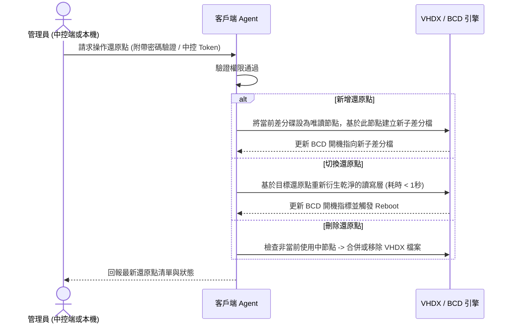

# 區域網路還原與映像派送系統 — 技術規格白皮書 (`SPEC.md`)

> [!IMPORTANT]
> 本文件為 **規格驅動開發（Spec-Driven Development）** 的唯一真實來源（Single Source of Truth）。所有前端 UI、Go 中控端核心、客戶端 Agent 與自動化腳本皆須嚴格遵守本規格定義之資料結構與通訊契約。

---

## 1. 系統架構與設計原則

### 1.1 核心架構模式：Thin Core + Independent Workers
- **中控端（Control Hub）**：採用 **Go (Golang)** 建構單一執行檔，內嵌 **React + Tailwind CSS** 前端靜態資源與 **SQLite** 輕量資料庫。
- **客戶端代理（Client Agent）**：採用 **Go** 編譯為 Windows 系統服務（Windows Service），附加輕量級本機管理 GUI（所有敏感操作強制驗證管理員密碼）。
- **底層功能模組（Workers）**：
  - `wol_worker`：發送 UDP Magic Packet 喚醒指定電腦。
  - `vhdx_worker`：操作 Windows `diskpart` 與 `bcdedit` 管理差分虛擬硬碟還原點。
  - `pxe_worker`：提供微型 DHCP Proxy / TFTP / HTTP 引導服務，載入救援環境（WinPE）。
  - `multicast_worker`：封裝並調用 `udp-sender`（母機端）與 `udp-receiver`（子機端）進行點對多高速直傳。
  - `net_preserve_worker`：負責派送前備份 IP/電腦名稱，以及派送後自動注入還原。

```mermaid
flowchart TB
    subgraph ControlCenter["中控端 (Go Thin Core + Web UI)"]
        UI["React 監控儀表板"]
        Hub["Go Core (State & WebSocket Hub)"]
        DB[("SQLite (IP 分組/密碼/任務紀錄)")]
        PXE["PXE / HTTP 引導模組"]
        WOL["WOL 喚醒模組"]
        UI <-->|WebSocket / REST| Hub
        Hub <--> DB
        Hub --> PXE
        Hub --> WOL
    end

    subgraph MasterNode["母機客戶端 (Master Client)"]
        MAgent["Client Agent (Go Service)"]
        Sender["udp-sender (讀取硬碟串流)"]
    end

    subgraph TargetNodes["子機客戶端群組 (Target Clients - 依 IP 分組)"]
        TAgent["Client Agent (Go Service)"]
        NetSnap["Network State Snapshot (IP/Hostname 備忘)"]
        Receiver["udp-receiver (寫入硬碟)"]
        VHDX["VHDX 差分還原點引擎"]
    end

    Hub <-->|指令與心跳 (TCP/WS)| MAgent
    Hub <-->|指令與心跳 (TCP/WS)| TAgent
    WOL -.->|UDP Magic Packet| TargetNodes
    Sender ===>|UDP Multicast 高速直傳串流| Receiver
```

---

## 2. 核心資料結構定義 (Data Schemas)

### 2.1 網路身分快照 (`NetworkIdentity`)
用於派送前備忘客戶端原始網路狀態，並在映像檔覆蓋完成後原樣復原。

```json
{
  "mac_address": "AA:BB:CC:11:22:33",
  "ip_mode": "STATIC",
  "ip_address": "192.168.1.101",
  "subnet_mask": "255.255.255.0",
  "default_gateway": "192.168.1.1",
  "dns_servers": ["8.8.8.8", "1.1.1.1"],
  "original_hostname": "LAB-PC-01",
  "captured_at": "2026-11-10T23:00:00Z"
}
```
- `ip_mode`: 列舉值 `"STATIC"`（固定 IP）或 `"DHCP"`（自動取得）。
- 當 `ip_mode == "DHCP"` 時，派送後僅還原 `original_hostname`，並將網卡設回 DHCP 自動取得模式。

### 2.2 還原點結構 (`RestorePoint`)
客戶端與中控端皆可檢視、新增、刪除與切換的本機還原點（最大鏈深建議限制為 5 層）。

```json
{
  "point_id": "rp_20261110_01",
  "name": "期中考乾淨環境",
  "description": "已安裝 Office 與 Python 3.12",
  "vhdx_file": "D:\\RestoreStorage\\diff_20261110_01.vhdx",
  "parent_id": "rp_base",
  "is_base": false,
  "is_active": true,
  "created_by": "ADMIN_REMOTE",
  "created_at": "2026-11-10T10:30:00Z"
}
```

### 2.3 客戶端節點與 IP 群組 (`ClientNode` & `IPGroup`)
系統以 **IP 位址** 為管理與分組依據，不受電腦名稱是否重複影響。

```json
{
  "client_id": "cli_192_168_1_101",
  "current_ip": "192.168.1.101",
  "mac_address": "AA:BB:CC:11:22:33",
  "hostname": "LAB-PC-01",
  "group_id": "grp_row_1",
  "status": "ONLINE_WINDOWS",
  "auto_restore_on_reboot": true,
  "active_point_id": "rp_20261110_01",
  "restore_points": [],
  "network_snapshot": {},
  "last_seen": "2026-11-10T23:04:00Z"
}
```
- `status` 狀態機列舉：
  - `"OFFLINE"`：關機或離線
  - `"WAKING_UP"`：已發送 WOL 封包，等待回應
  - `"ONLINE_WINDOWS"`：正常進入 Windows 運作中
  - `"ENTERING_PE"`：正在重啟進入 PXE/WinPE 環境
  - `"READY_FOR_CAST"`：已在救援環境待命，準備發送或接收群播
  - `"DEPLOYING"`：映像檔派送/接收進行中
  - `"POST_RESTORING_NET"`：派送完畢，正在還原原始 IP 與電腦名稱
  - `"ERROR"`：執行異常

```json
{
  "group_id": "grp_row_1",
  "group_name": "A教室 - 第一排",
  "ip_list": [
    "192.168.1.101",
    "192.168.1.102",
    "192.168.1.103"
  ]
}
```

---

## 3. 安全與權限規格 (Security Contract)

1. **客戶端全面密碼保護**：
   - 客戶端本機 UI 預設為鎖定檢視狀態。
   - 執行以下任一操作時，必須通過管理員密碼驗證（PBKDF2 / Bcrypt Hash 比對）：
     - 切換還原點（Switch Restore Point）
     - 新增還原點（Create Restore Point）
     - 刪除還原點（Delete Restore Point）
     - 切換「重開機自動還原」開關
     - 修改中控端連線設定或卸載服務
2. **中控端密碼同步**：
   - 中控端可透過加密通道統一派發新的管理員密碼 Hash 至所有在線客戶端，離線客戶端於下次上線時自動同步。

---

## 4. 關鍵業務流程規格 (Core Workflows)

### 4.1 流程一：新增 / 切換 / 刪除還原點（秒級還原）


### 4.2 流程二：母機直傳群播派送 ＋ IP/名稱自記憶復原
此流程實現**「不經伺服器中轉檔案」**以及**「派送後自動變回原本 IP 與電腦名稱」**。

```mermaid
sequenceDiagram
    participant Hub as 中控端 (Go Hub)
    participant Master as 母機 (如 192.168.1.100)
    participant Targets as 目標子機群 (依 IP 選取)

    Note over Hub,Targets: 階段 1：派送前網路身分自記憶 (Pre-Deploy Snapshot)
    Hub->>Targets: 下達 PREPARE_DEPLOY 指令
    Targets->>Targets: 讀取當前網卡設定 (Static IP/Mask/GW/DNS 或 DHCP) 與電腦名稱
    Targets->>Hub: 回傳 NetworkIdentity 備份存檔 (以 MAC 為索引雙重保險)
    Targets->>Targets: 亦將 NetworkIdentity 寫入本機 EFI/隱藏保留區

    Note over Hub,Targets: 階段 2：引導進入傳輸環境
    Hub->>Master: 指示重啟進入 PXE/WinPE (角色：SENDER)
    Hub->>Targets: 指示重啟進入 PXE/WinPE (角色：RECEIVER)
    Master-->>Hub: 回報 READY_FOR_CAST
    Targets-->>Hub: 全數回報 READY_FOR_CAST

    Note over Hub,Targets: 階段 3：母機對子機 UDP Multicast 高速直傳
    Hub->>Master: 啟動 udp-sender (讀取母機系統磁區串流)
    Hub->>Targets: 啟動 udp-receiver (寫入子機目標磁區)
    Master ===>> Targets: UDP Multicast 區塊串流直傳
    Targets-->>Hub: 每秒回報寫入進度 (%)、傳輸速率 (MB/s)

    Note over Hub,Targets: 階段 4：派送後原地復原 IP 與電腦名稱 (Post-Deploy Restore)
    Targets->>Targets: 映像寫入完成，掛載新系統離線 Registry 與網卡設定
    Targets->>Hub: 以 MAC 查詢或讀取保留區之 NetworkIdentity
    alt 派送前為固定 IP (STATIC)
        Targets->>Targets: 離線注入原始 IP、子網遮罩、預設閘道、DNS 與原始電腦名稱
    else 派送前為動態分配 (DHCP)
        Targets->>Targets: 清除母機殘留靜態 IP，設為 DHCP 自動取得，並注入原始電腦名稱
    end
    Targets->>Targets: 重開機進入全新 Windows 系統
    Targets-->>Hub: 以「原本的 IP」重新連上中控端，回報 DEPLOY_SUCCESS！
```

---

## 5. 通訊協定契約 (API & WebSocket Events)

### 5.1 中控端 REST API
| 方法 | 路徑 | 說明 |
| :--- | :--- | :--- |
| `GET` | `/api/v1/clients` | 取得所有客戶端狀態與所屬 IP 群組 |
| `POST` | `/api/v1/groups` | 建立或更新 IP 群組（傳入 `group_name` 與 `ip_list`） |
| `POST` | `/api/v1/power/wol` | 喚醒指定 IP 清單或群組之客戶端 |
| `POST` | `/api/v1/restore-points/action` | 遠端命指定 IP 客戶端新增、切換或刪除還原點 |
| `POST` | `/api/v1/deploy/start` | 發起母機直傳任務（指定 `master_ip` 與 `target_ips`） |

### 5.2 WebSocket 即時事件 (`ws://<hub-ip>:8080/ws`)
```json
{
  "event": "DEPLOY_PROGRESS",
  "timestamp": "2026-11-10T23:10:05Z",
  "payload": {
    "task_id": "task_9981",
    "master_ip": "192.168.1.100",
    "speed_mbps": 420.5,
    "clients": [
      { "ip": "192.168.1.101", "progress": 68.5, "status": "DEPLOYING" },
      { "ip": "192.168.1.102", "progress": 68.5, "status": "DEPLOYING" }
    ]
  }
}
```

---

## 6. Vibe Coding 實作里程碑（開發順序建議）

1. **Milestone 1（核心與介面原型）**：建立 Go 中控端專案骨架、SQLite 資料表、React 中控台介面（支援 IP 分組管理、Mock 進度條展示）。
2. **Milestone 2（電源與雙向通訊）**：實作 Client Agent 心跳連線、密碼驗證機制、以及 `wol_worker` 網路喚醒功能。
3. **Milestone 3（本機 VHDX 還原點引擎）**：實作 Windows `diskpart` / `bcdedit` 自動化封裝，達成客戶端與中控端秒級切換/新增/刪除還原點。
4. **Milestone 4（母機直傳與 IP 自記憶還原）**：整合 `udpcast` 群播指令控制，以及派送前後 `NetworkIdentity`（IP 與電腦名稱）自動備份與離線注入腳本。
