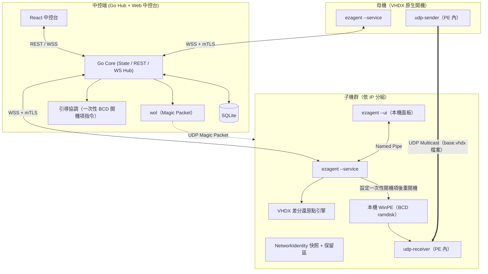
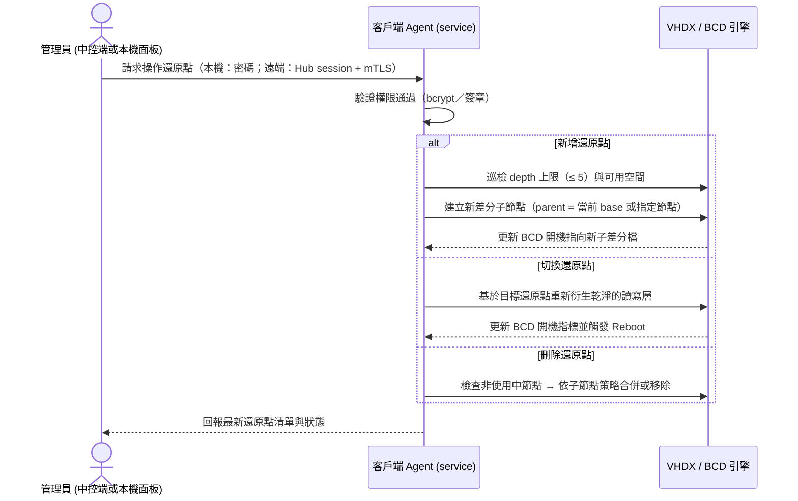

# 區域網路還原與映像派送系統 — 技術規格白皮書 (`SPEC.md`)

> [!IMPORTANT]
> 本文件為 **規格驅動開發（Spec-Driven Development）** 的唯一真實來源（Single Source of Truth）。所有前端 UI、Go 中控端核心、客戶端 Agent 與自動化腳本皆須嚴格遵守本規格定義之資料結構與通訊契約。

## 0. 文件資訊與術語

### 0.1 文件資訊

| 版本 | 日期 | 狀態 | 變更摘要 |
| :--- | :--- | :--- | :--- |
| v1.0 | 2026-11-11 | **已定案** | 併入 [`DECISIONS.md`](./DECISIONS.md) D1–D8（全數採用建議選項 A）；補齊 REST/WS 契約、狀態機、環境需求、引導與救援策略、初次建置流程、連接埠與設定檔 |

- 相關文件：[`AGENT.md`](./AGENT.md)（AI 開發守則）、[`TASKS.md`](./TASKS.md)（任務分解）、[`DECISIONS.md`](./DECISIONS.md)（決策記錄）
- 本文件所有時間一律為 **UTC RFC 3339**（例：`2026-11-10T23:10:05Z`）；對外顯示時再由 UI 轉為本地時間。

### 0.2 術語表

| 術語 | 定義 |
| :--- | :--- |
| 中控端（Hub） | 單一 Go 執行檔：REST/WS 伺服器 ＋ 內嵌 Web UI ＋ SQLite |
| 中控台（Web UI） | 中控端內嵌的 React SPA，管理員操作介面 |
| Agent | 客戶端 Windows 服務（LocalSystem）：`ezagent.exe --service` |
| 本機面板 | 同一執行檔的 `--ui` 模式，於登入使用者 session 顯示（WebView2） |
| 母機（Master／Sender） | 派送時提供 base 映像的機器 |
| 子機（Target／Receiver） | 派送時接收映像的機器 |
| base | 還原點鏈的根節點（`depth = 0`），即 Windows 實際安裝所在的 VHDX 檔 |
| 還原點（RestorePoint） | 以 VHDX 差分鏈實作的秒級還原節點 |
| PE | Windows PE 救援環境（本機 BCD ramdisk 開機，**不使用 PXE**） |
| 保留區 | 不參與映像派送的本機分割區／目錄，存放 `base.vhdx`、PE 映像、`NetworkIdentity` 備份 |
| DryRun | 模擬執行模式：只輸出指令腳本與日誌，不動真實磁碟／BCD |

---

## 1. 系統架構與設計原則

### 1.1 核心架構模式：Thin Core + Independent Workers

- **中控端（Control Hub）**：Go 單一執行檔，內嵌 React 靜態資源與 SQLite。不經手映像位元組，只負責狀態、指令與進度彙整。
- **客戶端代理（Client Agent）**：`ezagent.exe` 雙模式（決策 D1）
  - `--service`：Windows Service（LocalSystem），心跳、指令執行、VHDX／BCD 操作、密碼驗證、本機 IPC 服務端。
  - `--ui`：登入使用者 session 的托盤常駐程式，內嵌 WebView2 顯示**本機鎖定面板**；不具任何特權，所有變更經由本機 IPC 轉送服務。
- **底層功能模組（Workers）**：概念名稱**必須等於 Go package 名稱**（舊稱 `wol_worker` / `vhdx_worker` / `pxe_worker` / `multicast_worker` / `net_preserve_worker` 一律廢止，對照表見 [`AGENT.md`](./AGENT.md) §8）。
  - `wol`（`internal/workers/wol`）：WOL Magic Packet 與廣播位址計算。
  - `vhdx`（`internal/workers/vhdx`）：差分 VHDX 鏈、BCD 開機指標、離線磁碟操作（`diskpart` / `bcdedit`）。
  - `netpreserve`（`internal/workers/netpreserve`，含 `capture` / `restore`）：派送前網路身分快照與派送後離線注入。
  - `multicast`（`internal/workers/multicast`）：`udp-sender` / `udp-receiver` 進程控制、檔案模式群播、進度解析、SHA-256 校驗。
  - `pxe`（`internal/workers/pxe`）：**不在 M1–M4 範圍**。僅作為未來「無法從本機 PE 開機」的救援備援（決策 D2），目前不建立目錄與程式碼。

> [!NOTE]
> 本系統**不使用 PXE/DHCP/TFTP** 作為主要引導路徑。引導方式見 §1.3。



### 1.2 環境與平台需求（決策 D4）

| 項目 | 要求 | 說明 |
| :--- | :--- | :--- |
| 作業系統 | Windows 10/11 **Pro / Enterprise / Education** | VHDX 原生開機僅支援這些版本；**Home 版不支援，系統不得部署於 Home** |
| 韌體／分割 | UEFI ＋ GPT | BCD ramdisk 開機與 `bcdboot` 流程以 UEFI 為基準；Legacy BIOS 不在支援範圍 |
| Secure Boot | 可保持開啟 | WinPE 與開機管理程式為 Microsoft ADK 簽章，無須關閉 |
| Fast Startup／休眠 | **必須關閉**（`powercfg /h off`） | 否則「關機」實為 hybrid S4，WOL 從 S5 常失效 |
| BitLocker | **關閉** | VHDX 原生開機與離線注入不相容；教室環境不得啟用 |
| 記憶體 | ≥ 4 GB | WinPE ramdisk 開機需要 |
| 磁碟空間 | ≥ base 最大值 ＋ 所有還原點（差分量）＋ PE 映像（約 1 GB） | 動態 VHDX 必須設定 `maximum`，避免吃滿實體碟 |
| WebView2 Runtime | 本機面板需要（Win10 1903+／Win11 內建） | 缺失時 `--ui` 顯示安裝提示並退回托盤選單 |
| 開發機需求 | Windows ADK（建置 WinPE）、Hyper-V 或實體測試機、Go 工具鏈、Node.js | 見 [`TASKS.md`](./TASKS.md) Task 0.1 |
| 網路 | Hub 與所有客戶端同一廣播域（或已設定群播路由） | WOL 與群播皆不跨 VLAN 轉送（見 §1.4） |

### 1.3 引導與救援策略（決策 D2）

**主路徑：本機 BCD ramdisk 開機至 WinPE（不使用 PXE）**

1. Hub 以 **WOL** 喚醒機器（可選；機器已開機時略過）。
2. 機器進入 **Windows**，`ezagent --service` 啟動並以 WSS + mTLS 連上 Hub。
3. Hub 下 `CMD_ENTER_PE`；Agent 備份 BCD，設定**一次性** PE 開機項（`{ramdiskoptions}` 指向本機 `boot.wim`），回報後重開機。
4. `bootmgr` 從本機硬碟載入 WinPE（ramdisk 模式），PE 內 Agent 啟動、套用派送前保存的 `NetworkIdentity` 取得網路，回報 `READY_FOR_CAST`。

> [!WARNING]
> **主路徑的必要條件：目標機必須能進入 Windows 並執行 Agent**。若 Windows 已損壞到無法開機，主路徑不存在觸發者（WOL 只會把機器開到修復畫面）。此情境走次要路徑。

**次要路徑（已定案）：USB WinPE 救援（F1）**

- 使用與 Task 3.5 **同一份** WinPE 映像製成可開機 USB；插上後由 BIOS 選單開機（或設定 USB 優先）。
- PE 內 Agent 自動連上 Hub，之後流程與主路徑階段 3 之後完全相同（群播、校驗、切換）。
- 成本：每台人工約 2–3 分鐘；教室規模（20–60 台）且壞機頻率不高時可接受。

**不在範圍**：ProxyDHCP／PXE 引導（原 D2-B）暫列 backlog，只有在「壞機比例高且無法人工介入」時才重新評估。

### 1.4 資料流與網路原則

1. **Hub 不搬映像**：影像位元組只由母機以 UDP 群播直送子機；Hub 只下指令與收進度。
2. **WOL 與群播皆限同一廣播域**：跨 VLAN 需網路設備設定（群播路由／directed broadcast），否則不支援。
3. **PE 內磁碟定位**：不得依賴磁碟機代號（PE 與 Windows 的代號可能不同），一律用磁碟簽章或 volume GUID 定位保留區。
4. **預設 DryRun**：所有會改寫磁碟、BCD 的操作在非正式環境一律 `DryRun = true`（見 [`AGENT.md`](./AGENT.md) §4.1）。
5. **先快照、後派送**：任何群播開始前，必須已收妥所有目標的 `NetworkIdentity`（見 §2.4、§4.2）。

---

## 2. 核心資料結構定義 (Data Schemas)

### 2.1 網路身分快照 (`NetworkIdentity`)

用於派送前備忘客戶端原始網路狀態，並在映像檔覆蓋完成後原樣復原。

```json
{
  "mac_address": "AA:BB:CC:11:22:33",
  "ip_mode": "STATIC",
  "ip_address": "192.168.1.101",
  "subnet_mask": "255.255.255.0",
  "default_gateway": "192.168.1.1",
  "dns_servers": ["8.8.8.8", "1.1.1.1"],
  "original_hostname": "LAB-PC-01",
  "captured_at": "2026-11-10T23:00:00Z"
}
```

- `ip_mode`：列舉值 `"STATIC"`（固定 IP）或 `"DHCP"`（自動取得）。
- 當 `ip_mode == "DHCP"` 時，派送後僅還原 `original_hostname`，並將網卡設回 DHCP 自動取得模式。
- `dns_servers`：最多兩筆；`ip_mode == "DHCP"` 時可為空陣列。
- 本版**僅支援單一主要網卡**（多網卡／雙 IP 列 backlog）。

### 2.2 還原點結構 (`RestorePoint`)

客戶端與中控端皆可檢視、新增、刪除與切換的本機還原點。差分鏈深度以 `depth` 表示（base 為 `0`），**上限為 5（MUST）**；超過上限時新增操作必須被拒絕（`RESTORE_POINT_LIMIT`），不得自動合併。所謂「切換」僅指重建乾淨讀寫層並改寫開機指標（不含重開機時間）。

```json
{
  "point_id": "rp_20261110_01",
  "name": "期中考乾淨環境",
  "description": "已安裝 Office 與 Python 3.12",
  "vhdx_file": "diff_20261110_01.vhdx",
  "parent_id": "rp_base",
  "depth": 1,
  "size_bytes": 0,
  "is_base": false,
  "is_active": true,
  "state": "READY",
  "created_by": "ADMIN_REMOTE",
  "created_at": "2026-11-10T10:30:00Z"
}
```

**欄位規則**
- `depth`：base 為 `0`，子節點 = `parent.depth + 1`；有效範圍 `0 ≤ depth ≤ 5`。
- `size_bytes`：該差分檔實際佔用位元組；尚未計量時為 `0`。
- `state`：`READY`（可用）、`CREATING`（建立中）、`MERGING`（合併中，**屬非秒級操作**）、`BROKEN`（檔案缺失或父節點遺失）。
- `is_active`：同一 `client_id` 底下**僅能有一個** `true`。
- `created_by`：`ADMIN_LOCAL`（本機面板）、`ADMIN_REMOTE`（中控端）、`SYSTEM`（系統自動建立，例如派送後基準點）。
- `vhdx_file`：相對於客戶端保留區根目錄的路徑；不得使用絕對路徑（PE 與 Windows 的磁碟機代號不同）。
- 刪除規則：`is_active == true` 的節點**禁止刪除**（`INVALID_STATE`）；有子節點時必須先處理子節點（合併或先刪），不得直接刪除父節點。

### 2.3 客戶端節點與 IP 群組 (`ClientNode` & `IPGroup`)

系統以 **IP 位址** 為管理與分組依據，不受電腦名稱是否重複影響。`client_id` 必須是**安裝時產生、永久不變**的穩定鍵，**禁止由 IP 或 MAC 推導**（IP 會隨 DHCP 變動，MAC 可能有多張網卡或變更），否則歷史任務與還原點會斷鏈。

```json
{
  "client_id": "cli_9f2c4b1e8a7d4c3f",
  "current_ip": "192.168.1.101",
  "mac_address": "AA:BB:CC:11:22:33",
  "mac_source": "AGENT",
  "hostname": "LAB-PC-01",
  "os_edition": "Windows 11 Education",
  "agent_version": "0.1.0",
  "pe_ready": true,
  "group_id": "grp_row_1",
  "status": "ONLINE_WINDOWS",
  "auto_restore_on_reboot": true,
  "active_point_id": "rp_20261110_01",
  "restore_point_ids": ["rp_base", "rp_20261110_01"],
  "network_snapshot": {},
  "last_task_id": null,
  "progress_percent": null,
  "error_message": null,
  "last_seen": "2026-11-10T23:04:00Z"
}
```

**欄位規則**
- `client_id`：格式 `^cli_[0-9a-f]{16}$`（安裝時產生之 UUID 前 16 碼）；舊格式 `cli_192_168_1_101`（由 IP 推導）**廢止**。
- `current_ip`：可變欄位；群組劃分以 `IPGroup.ip_list` 為準。
- `mac_address`：小寫冒號格式 `aa:bb:cc:11:22:33`；未知時為 `null`。
- `mac_source`：`AGENT`（Agent 上報）、`IMPORT`（匯入 CSV／DHCP lease）、`ARP`（Hub 掃描）、`MANUAL`（人工建檔）；未知時為 `null`。
- `os_edition`：`winver` 產品名稱字串；若為 Home 版，Hub 必須標記為**不支援還原點**並在 UI 顯示警示（決策 D4）。
- `pe_ready`：`true` 表示本機 PE 映像與一次性開機項皆已就緒，可接受 `CMD_ENTER_PE`。
- `restore_point_ids`：僅存 ID 參照（物件本體見 §2.2）。
- `network_snapshot`：派送前擷取的 `NetworkIdentity`；尚未擷取時為 `{}`。
- `progress_percent`：`0–100`；非派送中為 `null`。
- `error_message`：最近一次錯誤訊息；無錯誤為 `null`。
- `agent_version`：語意化版本字串。
- `last_task_id`：最近參與的 `DeployTask.task_id`；無則 `null`。
- `status` 狀態機列舉（**合法轉移見 §2.6**）：
  - `"OFFLINE"`：關機或離線
  - `"WAKING_UP"`：已發送 WOL 封包，等待回應
  - `"ONLINE_WINDOWS"`：正常進入 Windows 運作中
  - `"ENTERING_PE"`：正在重啟進入本機 WinPE
  - `"READY_FOR_CAST"`：已在救援環境待命，準備發送或接收群播
  - `"DEPLOYING"`：映像檔派送/接收進行中
  - `"VERIFYING"`：接收完成，正在校驗 SHA-256
  - `"POST_RESTORING_NET"`：派送完畢，正在還原原始 IP 與電腦名稱
  - `"ERROR"`：執行異常

```json
{
  "group_id": "grp_row_1",
  "group_name": "A教室 - 第一排",
  "ip_list": [
    "192.168.1.101",
    "192.168.1.102",
    "192.168.1.103"
  ],
  "created_at": "2026-11-09T08:00:00Z"
}
```

**`IPGroup` 欄位規則**
- `group_id`：格式 `^grp_[a-z0-9_]+$`；新建時可省略，由 Hub 產生。
- **唯一性（MUST）**：`ip_list` 具全域唯一約束——同一 IP 在任一時間點只能屬於**一個**群組；資料庫必須有 `UNIQUE(ip)` 對應約束，衝突時 API 回 `IP_IN_OTHER_GROUP`（見 §5.1）。
- `ip_list`：正規化 IPv4 字串，去重並排序後儲存。
- 允許先將尚未上線的 IP 建入群組；該 IP 尚無 `ClientNode` 時，於 UI 顯示為預留項，待 Agent 首次回報後補齊。

### 2.4 派送任務 (`DeployTask`)

母機直傳群播任務的唯一識別物件；`task_id` 會出現在 WebSocket `DEPLOY_PROGRESS` payload 與 `GET /api/v1/tasks` 回應中。

```json
{
  "task_id": "task_9981",
  "state": "CASTING",
  "master_ip": "192.168.1.100",
  "target_ips": ["192.168.1.101", "192.168.1.102"],
  "image_sha256": "9f2c4b1e8a7d4c3f0a1b2c3d4e5f60718293a4b5c6d7e8f9012345678abcdef",
  "image_bytes": 32212254720,
  "image_path": "base.vhdx",
  "resets_restore_points": true,
  "created_at": "2026-11-10T23:08:00Z",
  "started_at": "2026-11-10T23:09:12Z",
  "finished_at": null,
  "error_code": null,
  "error_message": null
}
```

- `state` 狀態機列舉（**合法轉移見 §2.6**）：
  - `PENDING_PREPARE`：任務已建立，尚未下達 `CMD_PREPARE_DEPLOY`
  - `PREPARING`：已下達前置快照指令，等待 `NetworkIdentity` 回收
  - `READY`：**所有** `target_ips` 的 `NetworkIdentity` 皆已收妥，且全數回報 `READY_FOR_CAST`
  - `CASTING`：群播寫入中
  - `VERIFYING`：所有子機接收完成，等待 SHA-256 校驗結果
  - `POST_RESTORE`：校驗通過、已切換 base，子機正在還原網路身分
  - `SUCCEEDED` / `FAILED` / `CANCELLED`：終態
- `image_sha256`：母機 base 檔案的 SHA-256（小寫 hex）；Hub 在 `READY` 前取得並隨指令下發，子機接收後比對。
- `image_bytes`：base 檔位元組數，用於進度百分比計算。
- `image_path`：保留區內的固定相對路徑（母機與所有子機必須一致）。
- `resets_restore_points`：`true` 表示派送完成後清除舊差分鏈並建立新基準點（決策 D8，固定為 `true`）。
- **紅線**：任一目標的 `NetworkIdentity` 未收妥時，`state` **不得**進入 `READY`，`CASTING` 亦不得開始（對應 [`AGENT.md`](./AGENT.md) §4.2）。
- 同一時間僅允許一個 `state ∉ {SUCCEEDED, FAILED, CANCELLED}` 的任務存在；重複發起回 `DEPLOY_IN_PROGRESS`。

### 2.5 WebSocket 訊息封套 (`WSMessage`)

所有 WebSocket 訊息（瀏覽器通道與 Agent 通道）共用同一封套：

```json
{
  "v": 1,
  "seq": 128,
  "event": "CLIENT_STATUS_CHANGED",
  "timestamp": "2026-11-10T23:10:05Z",
  "payload": {}
}
```

- `v`：契約版本，目前固定 `1`。
- `seq`：Hub 端單調遞增序號（每條連線各自計數），用於偵測漏事件與 Debug。
- `event`：唯一合法值列舉如下，**禁止自行新增未定義事件**（payload 定義見 §5.2、§5.3）：
  - 瀏覽器通道（Hub → 中控台）：`HELLO`、`CLIENT_STATUS_CHANGED`、`CLIENT_UPSERTED`、`GROUP_UPDATED`、`RESTORE_POINTS_UPDATED`、`WOL_SENT`、`TASK_CREATED`、`DEPLOY_PROGRESS`、`DEPLOY_FINISHED`、`DEPLOY_FAILED`、`AGENT_ERROR`
  - Agent 指令（Hub → Agent）：`CMD_PREPARE_DEPLOY`、`CMD_ENTER_PE`、`CMD_START_SENDER`、`CMD_START_RECEIVER`、`CMD_ABORT`、`CMD_COLLECT_RESTORE_POINTS`、`CMD_SYNC_PASSWORD`、`CMD_PING`
  - Agent 上報（Agent → Hub）：`AGENT_HELLO`、`AGENT_STATUS`、`AGENT_PROGRESS`、`NETWORK_IDENTITY`、`IMAGE_VERIFY_RESULT`、`CMD_RESULT`

### 2.6 狀態機轉移表（唯一合法轉移）

**客戶端 `status`（§2.3）**

| From | 允許的 To | 觸發 |
| :--- | :--- | :--- |
| `OFFLINE` | `WAKING_UP` | `POST /api/v1/power/wol` 已送出 Magic Packet |
| `OFFLINE` | `READY_FOR_CAST` | PE 內 Agent 主動連線（USB 救援，或 Windows 未上線時由本機 PE 開機） |
| `WAKING_UP` | `ONLINE_WINDOWS` | Agent 心跳恢復 |
| `WAKING_UP` | `OFFLINE` | 逾時（預設 120 秒）未收到心跳 |
| `ONLINE_WINDOWS` | `ENTERING_PE` | 下達 `CMD_ENTER_PE` 並取得 `CMD_RESULT` |
| `ONLINE_WINDOWS` | `OFFLINE` | 心跳逾時 |
| `ENTERING_PE` | `READY_FOR_CAST` | PE 內 Agent 回報 |
| `ENTERING_PE` | `ERROR` | 引導失敗或逾時 |
| `READY_FOR_CAST` | `DEPLOYING` | `CMD_START_SENDER` / `CMD_START_RECEIVER` 成功 |
| `READY_FOR_CAST` | `ONLINE_WINDOWS` | 任務取消，子機重開回原系統 |
| `DEPLOYING` | `VERIFYING` | 接收進度 100% |
| `VERIFYING` | `POST_RESTORING_NET` | SHA-256 校驗通過 |
| `VERIFYING` | `ERROR` | 校驗失敗（`IMAGE_VERIFY_FAILED`） |
| `POST_RESTORING_NET` | `ONLINE_WINDOWS` | 以原始 IP 重新連上 Hub |
| 任一狀態 | `ERROR` | Agent 回報錯誤或指令逾時 |
| `ERROR` | `OFFLINE` / `ONLINE_WINDOWS` | 管理員清除錯誤後重新連線 |

- 上表為**封閉集合**：未列出的轉移一律視為非法。Hub 收到非法轉移時必須忽略該回報、記錄 WARN，並回 `INVALID_STATE`，不得寫入 DB。
- `DEPLOYING` / `VERIFYING` / `POST_RESTORING_NET` 期間，不得接受新的還原點操作，也不得發起第二次派送。

**任務 `DeployTask.state`（§2.4）**

| From | 允許的 To | 備註 |
| :--- | :--- | :--- |
| `PENDING_PREPARE` | `PREPARING` / `CANCELLED` | 管理員取消 |
| `PREPARING` | `READY` | 所有目標 `NetworkIdentity` 收妥 |
| `PREPARING` | `FAILED` / `CANCELLED` | 逾時或部分目標失敗 |
| `READY` | `CASTING` / `CANCELLED` | |
| `CASTING` | `VERIFYING` / `FAILED` | 全部子機接收完成才進 `VERIFYING` |
| `VERIFYING` | `POST_RESTORE` / `FAILED` | 全部校驗通過才切換 |
| `POST_RESTORE` | `SUCCEEDED` / `FAILED` | |
| `SUCCEEDED` / `FAILED` / `CANCELLED` | —（終態） | 不可再轉移 |

---

## 3. 安全與權限規格 (Security Contract)

### 3.1 客戶端密碼保護

客戶端本機 UI 預設為**唯讀鎖定**狀態。變更類操作一律需要授權，且授權來源依通道區分：

| 操作 | 本機面板 | 中控端（遠端） |
| :--- | :--- | :--- |
| 切換還原點 | 需本機管理員密碼 | 需 Hub 管理員 session ＋ mTLS 指令簽章 |
| 新增還原點 | 需本機管理員密碼 | 同上 |
| 刪除還原點 | 需本機管理員密碼 | 同上 |
| 切換「重開機自動還原」 | 需本機管理員密碼 | 同上 |
| 修改 Hub 連線設定／解除保護／卸載服務 | 需本機管理員密碼，且需 Windows 管理員權限（UAC） | 不支援遠端 |
| 檢視狀態與還原點清單 | 免密碼（唯讀） | 需 Hub 管理員 session |

- 本機密碼以 **bcrypt（cost 12）** 儲存於 Agent，比對一律在**服務端**（`--service`）完成，`--ui` 程序不得持有 hash。
- 驗證失敗：連續 5 次／5 分鐘鎖定並寫入稽核日誌（含時間、來源管道、失敗原因），不得回傳「密碼錯誤」以外的細節。
- 遠端操作的安全邊界為 **Hub 管理員 session ＋ mTLS**：Agent 以 `AGENT.md` §4.3 所述「有效中控端簽章」驗證指令來源，不要求二次密碼。
- **誠實聲明**：本機 Windows 管理員可透過停用服務、替換執行檔等方式繞過密碼鎖。密碼鎖的防護對象是**一般使用者（學生）**，不是本機管理員。UI 與文件不得宣稱可防止管理員層級篡改。

### 3.2 中控端認證與授權（決策 D6）

- 單一管理員帳號，密碼以 bcrypt（cost 12）儲存於 SQLite。
- `POST /api/v1/auth/login` 成功後發放 **Session Cookie**：`HttpOnly; Secure; SameSite=Strict; Path=/`；Session 存 SQLite，**閒置 8 小時**逾時，登出即刻作廢。
- 所有變更類請求需附 **CSRF Token**（登入時回傳，前端置於 `X-CSRF-Token` header）。
- 登入失敗限流：同一帳號 5 次／5 分鐘，超過回 `429`；同時寫入稽核日誌。
- WebSocket 握手以同一 Session Cookie 驗證；驗證失敗直接關閉連線（關閉碼 `4401`）。
- 首次啟動：產隨機 bootstrap 密碼輸出到主控台，登入後強制變更；bootstrap 密碼不得寫入檔案。
- CORS 預設關閉（UI 為同源內嵌資源）；所有非同步請求僅允許同源。

### 3.3 通道安全與 Agent 身分（決策 D5）

- 所有 Hub ↔ 瀏覽器、Hub ↔ Agent 通訊一律 **HTTPS / WSS（TLS 1.2+，優先 1.3）**；明文本埠預設關閉。
- 首次啟動由 Hub 產生**自簽 CA** 與 server cert；憑證存放於設定目錄，權限僅 SYSTEM／服務帳號可讀。
- Agent 註冊採「一次性安裝 token」：`ezagent.exe --enroll <token>`，以 token 換發 **client cert**，之後所有連線皆 **mTLS**。
- 憑證效期 1 年；到期前 30 天由 Hub 透過既有 mTLS 連線重新簽發，Agent 自動更新。
- 瀏覽器第一次連線會看到自簽警告；以「匯入內部 CA 憑證」或「憑證指紋釘選」處理（部署文件化）。
- **不得以明文傳輸任何密碼或密碼雜湊**（見 §3.5）。

### 3.4 本機 IPC 契約（決策 D1）

- 通道：**Windows Named Pipe** `\\.\pipe\ezrestore-agent`；訊息格式為 **NDJSON**（一行一個 JSON 物件），UTF-8。
- ACL：`SYSTEM` 與 `Administrators` 完全控制；`Authenticated Users` 允許連線但僅能呼叫唯讀方法。
- 請求：`{ "id": 1, "method": "SwitchRestorePoint", "params": { ... } }`
- 回應：`{ "id": 1, "ok": true, "result": { ... } }` 或 `{ "id": 1, "ok": false, "error": { "code": "...", "message": "..." } }`
- 錯誤碼沿用 §5.1 封閉集合；另加 `PASSWORD_REQUIRED`、`RATE_LIMITED`。

| 方法 | 權限 | 說明 |
| :--- | :--- | :--- |
| `GetAgentInfo` | 唯讀 | `client_id`、`agent_version`、`os_edition`、`pe_ready`、`status` |
| `GetStatus` | 唯讀 | 心跳狀態、`active_point_id`、目前任務 |
| `ListRestorePoints` | 唯讀 | `RestorePoint[]` |
| `CreateRestorePoint` | 需密碼 | `params: { password, name, description }` |
| `SwitchRestorePoint` | 需密碼 | `params: { password, point_id }` |
| `DeleteRestorePoint` | 需密碼 | `params: { password, point_id }` |
| `SetAutoRestore` | 需密碼 | `params: { password, enabled }` |
| `SetHubEndpoint` | 需密碼＋UAC | `params: { password, hub_url, enroll_token }` |
| `UninstallService` | 需密碼＋UAC | 停止並移除服務（同時移除 PE 開機項與保留區設定） |
| `Subscribe` | 唯讀 | 訂閱狀態事件（`status`、`progress`、`restore_points`） |

- `--ui` 程序不得快取密碼；每次操作由使用者重新輸入。
- 同一 pipe 上的變更方法共用 §3.1 的失敗限流與稽核。

### 3.5 密碼同步（決策 D5）

- 中控端變更管理員密碼後，透過 mTLS 通道下發 `CMD_SYNC_PASSWORD`，payload 為**新密碼明文**；Agent 收到後自行以 bcrypt 儲存。
- **禁止傳送密碼雜湊**：舊版「派發 hash」的設計作廢（hash 可離線暴力破解）。
- 離線客戶端：Hub 保留待同步標記，於 Agent 下次上線（`AGENT_HELLO`）後立即補發，成功後清除標記並記錄稽核。
- 密碼同步不可用於「跳過本機驗證」；Agent 仍保留本機密碼驗證流程。

---

## 4. 關鍵業務流程規格 (Core Workflows)

### 4.1 流程一：新增 / 切換 / 刪除還原點（秒級還原）



> [!NOTE]
> 「秒級」僅指切換操作本身（重建讀寫層 + 改 BCD），**不含重開機時間**。

### 4.2 流程二：母機直傳群播派送 ＋ IP/名稱自記憶復原

此流程實現**「不經伺服器中轉檔案」**以及**「派送後自動變回原本 IP 與電腦名稱」**。

```mermaid
sequenceDiagram
    participant Hub as 中控端
    participant Agent as 子機 Agent (Windows)
    participant PE as 子機 WinPE Agent
    participant Master as 母機 (PE, SENDER)

    Note over Hub,PE: 階段 0：喚醒（機器已開機則略過）
    Hub-->>Agent: WOL Magic Packet（UDP 廣播）
    Agent-->>Hub: Windows 開機完成，WSS + mTLS 心跳

    Note over Hub,PE: 階段 1：派送前網路身分快照
    Hub->>Agent: CMD_PREPARE_DEPLOY
    Agent->>Agent: 讀取網卡設定（STATIC/DHCP、IP、遮罩、GW、DNS）與 hostname
    Agent-->>Hub: NETWORK_IDENTITY
    Agent->>Agent: 同步寫入本機保留區備份
    Agent-->>Hub: CMD_RESULT

    Note over Hub,PE: 階段 2：重開機進入本機 WinPE
    Hub->>Agent: CMD_ENTER_PE（role = RECEIVER）
    Agent->>Agent: 備份 BCD，設定一次性 PE 開機項（ramdisk boot.wim）
    Agent-->>Hub: CMD_RESULT，然後重開機
    PE-->>Hub: AGENT_HELLO（PE 模式）＋套用 NetworkIdentity 取得網路
    PE-->>Hub: AGENT_STATUS READY_FOR_CAST

    Note over Hub,PE: 階段 3：母機群播 base.vhdx（Hub 不經手位元組）
    Hub->>Master: CMD_START_SENDER（image_sha256 / image_bytes）
    Hub->>PE: CMD_START_RECEIVER（master_ip / image_sha256）
    Master ===>> PE: UDP Multicast（檔案模式，直送 base.vhdx）
    PE-->>Hub: AGENT_PROGRESS（每 2 秒：percent / speed_mbps）
    PE-->>Hub: IMAGE_VERIFY_RESULT（SHA-256 比對結果）

    Note over Hub,PE: 階段 4：切換與重開機
    PE->>PE: 校驗通過 → base.vhdx.new 切換為 base.vhdx
    PE-->>Hub: CMD_RESULT
    PE->>PE: 重開機進入新 base（BCD 指回 Windows）
    Agent-->>Hub: 以「原本的 IP」重新連上，回報 DEPLOY_SUCCESS
```

**派送前置條件（MUST）**

1. 所有 `target_ips` 的 `NetworkIdentity` 皆已收妥（§2.4 紅線）。
2. 母機與所有子機的 `pe_ready == true`（PE 映像存在且開機項可用）。
3. 所有參與者位於同一群播廣播域（§1.4）。
4. 子機保留區可用空間 ≥ `image_bytes` × 1.05（暫存 `.new` 檔）。
5. 沒有其他進行中的 `DeployTask`。

**失敗處理**

- 任一子機接收逾時或校驗失敗：任務進 `FAILED`，WS 推播 `DEPLOY_FAILED`（含 `failed_ips`），**不得**切換任何子機的 base（全數保持原狀）。
- 部分子機成功、部分失敗：視為 `FAILED`；已接收完成的子機不得自行切換（保持 `.new` 檔，供管理員決定重試或清除）。
- 群播中斷：Hub 可重新發起同一任務（`retry`）；若母機檔案已變更（SHA-256 不同）必須建立新任務，不得沿用舊 `task_id`。

### 4.3 救援流程（Windows 無法開機時）


- 觸發條件：目標機 Windows 無法啟動、或 `pe_ready == false` 且無法自動修復。
- 救援任務同樣使用 `DeployTask` 模型，但由管理員在 Hub 上手動建立（不經 Wait-for-READY 自動流程亦可），`created_by = ADMIN_REMOTE`。
- Hub 必須能從 PE 的 `AGENT_HELLO`（`client_id` ＋ `mac_address`）辨識機器，因此 **client_id 必須在重裝後不變**：`client_id` 存放於保留區，與 base `vhdx` 同層。
- 每次救援須寫入稽核（誰、何時、哪台、用哪個 image）。

### 4.4 初次建置流程：實體機 → VHDX 原生開機

一次性建置，每台機器執行一次（可由母機群播或現場執行）。

1. 以 USB WinPE 開機。
2. 在保留分割區建立動態 VHDX（設定 `maximum` 上限），掛載後建立 GPT 分割（ESP 400 MB ＋ MSR ＋ NTFS 主分割）。
3. 套用映像到 VHDX 內主分割：`dism /Apply-Image`（母機 WIM）或自母機 `base.vhdx` 複製。
4. 以 `bcdboot` 在 VHDX 的 ESP 建立開機檔，BCD 開機項指向 VHDX（`device vhd=`）。
5. 將 WinPE `boot.wim` 複製到保留區，建立 PE 開機項（`{ramdiskoptions}`），並驗證可開機。
6. 於虛擬系統內安裝 `ezagent.exe`、寫入 `client_id` 與保留區結構、加入 Hub（`--enroll`）。
7. 驗收：能從 VHDX 開機進 Windows、`pe_ready == true`、能執行一次新增／切換／刪除還原點、能在 `DryRun=false` 下正確重開機進 PE。

> [!WARNING]
> 步驟 2、4、5、6 皆涉及開機設定與磁碟分割，屬高風險操作，必須由 Task 3.6 的腳本執行並在 DryRun 下先演練。

---

## 5. 通訊協定契約 (API & WebSocket Events)

### 5.1 中控端 REST API

**共通規範**
- 請求／回應一律 `application/json`；時間一律 UTC RFC 3339。
- 成功：`{ "ok": true, "data": <payload> }`；失敗：`{ "ok": false, "error": { "code": "...", "message": "...", "details": {} } }`。
- 除 `auth/login` 外，所有端點皆需有效 Session（§3.2）；未通過一律 `401 UNAUTHORIZED`。
- 變更類請求需 `X-CSRF-Token` header，缺少或錯誤回 `403 FORBIDDEN`。
- **批次語意**：變更類端點接受 `"targets": { "ips": ["..."], "group_id": "..." }`（兩者擇一或併用；`group_id` 展開為其 `ip_list`），回應固定為 `"results": [{ "ip": "...", "ok": true, "error": null }]`；單台失敗不影響其他台。

| 方法 | 路徑 | 說明 |
| :--- | :--- | :--- |
| `POST` | `/api/v1/auth/login` | `{ "password": "..." }` → 設 Session Cookie，回傳 `{ "csrf_token": "..." }` |
| `POST` | `/api/v1/auth/logout` | 作廢 Session |
| `POST` | `/api/v1/auth/password` | `{ "old_password", "new_password" }`（變更後觸發 §3.5 同步） |
| `GET` | `/api/v1/clients` | 全量客戶端（`ClientNode[]`），可帶 `?group_id=` |
| `GET` | `/api/v1/clients/{ip}` | 單一客戶端狀態 |
| `PATCH` | `/api/v1/clients/{ip}/settings` | 切換 `auto_restore_on_reboot` 等設定 |
| `POST` | `/api/v1/clients/macs/import` | 匯入 `ip,mac` CSV（決策 D7，`multipart/form-data`） |
| `GET` | `/api/v1/groups` | 群組清單（`IPGroup[]`） |
| `POST` | `/api/v1/groups` | 建立或更新群組（省略 `group_id` 視為新建） |
| `DELETE` | `/api/v1/groups/{group_id}` | 刪除群組（不影響客戶端狀態與還原點） |
| `POST` | `/api/v1/power/wol` | 喚醒指定 IP／群組（`targets`） |
| `GET` | `/api/v1/clients/{ip}/restore-points` | 讀取該客戶端還原點清單與 `active_point_id` |
| `POST` | `/api/v1/restore-points/action` | `{ "action": "create"\|"switch"\|"delete", "point_id"?, "name"?, "description"?, "targets": {...} }` |
| `POST` | `/api/v1/deploy/start` | `{ "master_ip": "...", "target_ips": ["..."] }`，成功回 `DeployTask` |
| `POST` | `/api/v1/deploy/cancel` | `{ "task_id": "..." }`；僅 `PENDING_PREPARE` / `PREPARING` / `READY` 可取消（§2.6） |
| `POST` | `/api/v1/deploy/retry` | `{ "task_id": "..." }`；僅 `FAILED` 且 image 未變更時允許 |
| `GET` | `/api/v1/tasks` | 任務清單（分頁 `?limit=&offset=`） |
| `GET` | `/api/v1/tasks/{task_id}` | 單一 `DeployTask` |
| `GET` | `/api/v1/audit` | 稽核日誌（分頁；僅管理員） |
| `POST` | `/api/v1/agent/enroll` | Agent 以安裝 token 換發 client cert（mTLS 之前的最後一個明文端點，限內網＋token） |
| `POST` | `/api/v1/agent/heartbeat` | 心跳與狀態補報（Agent 主通道為 WebSocket，此端點作離線補報） |

**錯誤碼（`error.code`，封閉集合）**

| 代碼 | HTTP | 意義 |
| :--- | :--- | :--- |
| `UNAUTHORIZED` | 401 | 未登入、密碼／Token 錯誤或已過期 |
| `FORBIDDEN` | 403 | 已登入但無此操作權限，或 CSRF 失敗 |
| `RATE_LIMITED` | 429 | 登入或密碼驗證失敗次數過多 |
| `INVALID_ARGUMENT` | 400 | 參數格式錯誤（IP、`group_id`、`action` 等） |
| `NOT_FOUND` | 404 | 對象不存在 |
| `INVALID_STATE` | 409 | 當前狀態不允許此操作（見 §2.6） |
| `IP_IN_OTHER_GROUP` | 409 | 目標 IP 已屬於其他群組（見 §2.3） |
| `RESTORE_POINT_LIMIT` | 409 | 差分鏈深度已達上限（見 §2.2） |
| `DEPLOY_IN_PROGRESS` | 409 | 已有進行中的派送任務 |
| `MAC_UNKNOWN` | 409 | 目標 MAC 未知，無法喚醒（見 §1.4 D7） |
| `PE_NOT_READY` | 409 | 目標機 PE 映像／開機項未就緒 |
| `CAPABILITY_UNSUPPORTED` | 409 | 目標機不支援此功能（例如 Home 版的還原點） |
| `IMAGE_VERIFY_FAILED` | 422 | 子機 SHA-256 校驗失敗 |
| `INTERNAL` | 500 | 未預期的伺服器錯誤 |

### 5.2 WebSocket 即時事件（瀏覽器通道）

- 端點：`wss://<hub>:8443/ws`（TLS 必開）；握手以 Session Cookie 驗證。
- 連線成功後 Hub 先送 `HELLO`。所有訊息一律包在 §2.5 的 `WSMessage` 封套內。
- **重連規則**：WebSocket 僅為推播通道，不保證不漏事件。前端重連成功後**必須**重新呼叫 `GET /api/v1/clients` 與 `GET /api/v1/tasks` 取全量狀態；`seq` 僅供偵測漏事件與 Debug，**不得**據此補資料。

| `event` | payload | 備註 |
| :--- | :--- | :--- |
| `HELLO` | `{ "server_time", "seq", "contract_version": 1 }` | 連線建立 |
| `CLIENT_STATUS_CHANGED` | `{ "client_id", "ip", "from", "to" }` | 見 §2.6 |
| `CLIENT_UPSERTED` | `{ "client": <ClientNode> }` | 首次回報或資料更新 |
| `GROUP_UPDATED` | `{ "group": <IPGroup> }` | |
| `RESTORE_POINTS_UPDATED` | `{ "ip", "restore_points": [<RestorePoint>] }` | |
| `WOL_SENT` | `{ "ips": ["..."], "macs": ["..."] }` | |
| `TASK_CREATED` | `{ "task": <DeployTask> }` | |
| `DEPLOY_PROGRESS` | `{ "task_id", "master_ip", "speed_mbps", "clients": [{ "ip", "progress", "status" }] }` | 任務進行中 |
| `DEPLOY_FINISHED` | `{ "task_id", "state": "SUCCEEDED", "finished_at" }` | 終態 |
| `DEPLOY_FAILED` | `{ "task_id", "error_code", "message", "failed_ips": ["..."] }` | 終態 |
| `AGENT_ERROR` | `{ "ip", "error_code", "message" }` | 非任務性錯誤 |

`DEPLOY_PROGRESS` 完整範例：

```json
{
  "v": 1,
  "seq": 128,
  "event": "DEPLOY_PROGRESS",
  "timestamp": "2026-11-10T23:10:05Z",
  "payload": {
    "task_id": "task_9981",
    "master_ip": "192.168.1.100",
    "speed_mbps": 105.2,
    "clients": [
      { "ip": "192.168.1.101", "progress": 68.5, "status": "DEPLOYING" },
      { "ip": "192.168.1.102", "progress": 68.5, "status": "DEPLOYING" }
    ]
  }
}
```

> [!NOTE]
> `speed_mbps` 為示意值。1GbE 實務上限約 118 MB/s；群播總速率另受交換器群播能力與接收端寫入速度限制，**不得**以本範例數字作為驗收基準。

### 5.3 客戶端指令通道（Hub ↔ Agent）

- 端點：`wss://<hub>:8443/ws/agent`；**必須 mTLS**（client cert 由 `POST /api/v1/agent/enroll` 換發）。
- Agent 連上後先送 `AGENT_HELLO`；Hub 以 client cert 的 `client_id` 綁定身分，**不得**只信任 payload 內的宣告值。
- 指令一律為 `WSMessage` 封套，`event` 以 `CMD_` 開頭，payload 必含 `cmd_id`（Hub 產生，Agent 必須原樣回帶）與 `expires_at`（逾時即作廢）。
- Agent 必須對每則指令回報 `CMD_RESULT`；Hub 逾時未收到時，將該客戶端標記為 `ERROR`（見 §2.6）。

**Hub → Agent 指令**

| `event` | payload | 預期效果 |
| :--- | :--- | :--- |
| `CMD_PREPARE_DEPLOY` | `{ "cmd_id", "task_id", "expires_at" }` | 回傳 `NETWORK_IDENTITY` |
| `CMD_ENTER_PE` | `{ "cmd_id", "role": "SENDER"\|"RECEIVER", "task_id", "expires_at" }` | 設定一次性 PE 開機項後重開機 |
| `CMD_START_SENDER` | `{ "cmd_id", "target_ips", "image_sha256", "image_bytes", "expires_at" }` | 母機開始群播（`DEPLOYING`） |
| `CMD_START_RECEIVER` | `{ "cmd_id", "master_ip", "image_sha256", "image_bytes", "expires_at" }` | 子機開始接收（`DEPLOYING`） |
| `CMD_ABORT` | `{ "cmd_id", "reason" }` | 中止當前動作並回報 |
| `CMD_COLLECT_RESTORE_POINTS` | `{ "cmd_id" }` | 回傳 `RestorePoint[]` |
| `CMD_SYNC_PASSWORD` | `{ "cmd_id", "new_password", "expires_at" }` | 更新本機 bcrypt hash（僅限 mTLS 通道） |
| `CMD_PING` | `{ "cmd_id" }` | 回 `CMD_RESULT` |

**Agent → Hub 上報**

| `event` | payload |
| :--- | :--- |
| `AGENT_HELLO` | `{ "client_id", "hostname", "os_edition", "agent_version", "mac_address", "current_ip", "pe_ready", "mode": "WINDOWS"\|"PE" }` |
| `AGENT_STATUS` | `{ "client_id", "status", "reason"? }` |
| `AGENT_PROGRESS` | `{ "task_id", "percent", "speed_mbps", "phase": "RECEIVING"\|"SENDING" }` |
| `NETWORK_IDENTITY` | `{ "task_id", "identity": <NetworkIdentity> }` |
| `IMAGE_VERIFY_RESULT` | `{ "task_id", "ok": true, "sha256": "..." }` |
| `CMD_RESULT` | `{ "cmd_id", "ok", "error"? }` |

### 5.4 連接埠與網路需求

| 用途 | 協定 | 埠 | 方向 | 備註 |
| :--- | :--- | :--- | :--- | :--- |
| Hub REST / Web UI | TCP | **8443** | 客戶端 → Hub | HTTPS；明文 8080 僅開發用，預設關閉 |
| Hub WebSocket（中控台） | TCP | 8443 | 瀏覽器 → Hub | WSS |
| Hub WebSocket（Agent） | TCP | 8443 | Agent → Hub | WSS + mTLS |
| WOL Magic Packet | UDP | 9 | Hub → 廣播位址 | 依群組子網計算廣播位址 |
| 群播映像傳輸 | UDP | 9000（可設定） | 母機 → 群播群組 | 預設群組 `239.255.42.42` |

- 防火牆僅需開放：Hub inbound TCP 8443；客戶端 outbound TCP 8443、UDP 9000（加入群播群組）、UDP 9（送出廣播）。
- **不需要** TFTP、DHCP、SMB、PXE 相關埠。

### 5.5 設定檔與預設值

設定優先序：**CLI 旗標 > 環境變數 > 設定檔 > 內建預設**。設定檔為執行檔同目錄的 `hub.yaml` / `agent.yaml`。

| 元件 | 鍵 | 預設 | 說明 |
| :--- | :--- | :--- | :--- |
| hub | `listen` | `:8443` | HTTPS/WSS 監聽位址 |
| hub | `db_path` | `data/hub.db` | SQLite 路徑 |
| hub | `tls_dir` | `data/tls` | CA／server cert 存放目錄 |
| hub | `session_ttl` | `8h` | Session 閒置逾時 |
| hub | `dry_run` | `true` | 全域 DryRun 預設值 |
| agent | `hub_url` | — | `https://<hub>:8443` |
| agent | `reserve_root` | `D:\\EZRestore` | 保留區根目錄（`base.vhdx`、diff、PE 映像） |
| agent | `pe_wim_path` | `%reserve_root%\\PE\\boot.wim` | 本機 PE 映像 |
| agent | `heartbeat` | `15s` | 心跳間隔 |
| agent | `dry_run` | `true` | 開發／測試機必須為 `true` |
| agent | `pipe_name` | `ezrestore-agent` | 本機 IPC pipe 名稱 |

---

## 6. 實作里程碑（開發順序）

> [!IMPORTANT]
> **Milestone 的唯一定義在 [`TASKS.md`](./TASKS.md)**。本節僅描述順序與依賴原則，不另立編號。

1. **M0 環境**：開發機工具鏈（Go、Node、WinPE ADK、Hyper-V 測試機）先就緒；沒有可驗證的環境，後續 Task 的「驗收」無法執行。
2. **M1 契約與骨幹**：`internal/protocol` 是所有其他 Milestone 的編譯期依賴；REST/WS/認證/通道安全完成後，M2 才有真實資料可用。
3. **M2 前端與本機面板**：可與 M3 部分平行，但只能使用 M1 已定案的契約。
4. **M3 電源、PE 引導與 VHDX**：3.4（PE 開機項）與 3.5（WinPE 映像）是 M4 的硬前置；3.6（初次建置）必須在實機測試前完成。
5. **M4 派送與復原**：完成 4.1–4.4 後才做 4.5 端到端驗收（含救援流程）。
6. **每個 Task 完成後**：更新 [`TASKS.md`](./TASKS.md) 勾選狀態與一行摘要，並確保 [`AGENT.md`](./AGENT.md) §5 的檢核指令全數通過。
